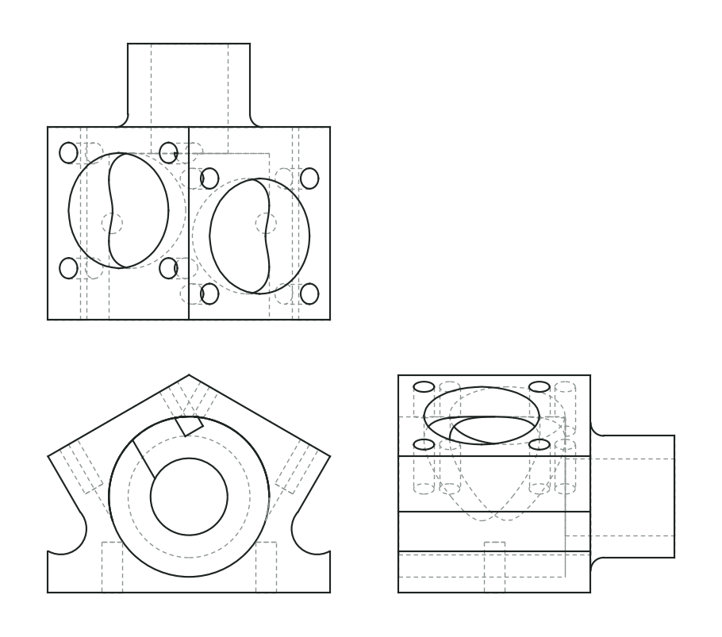
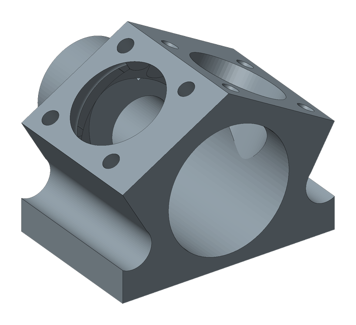
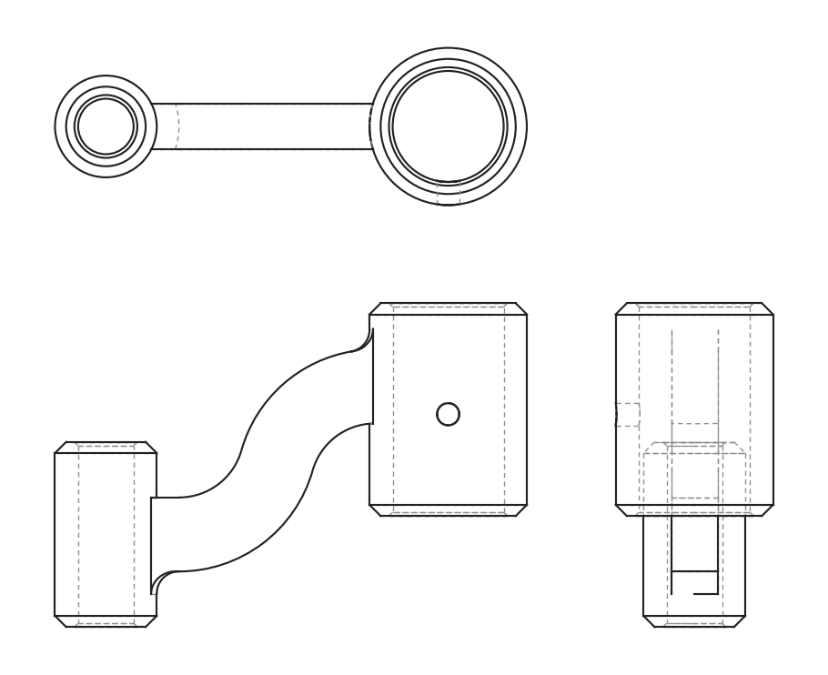
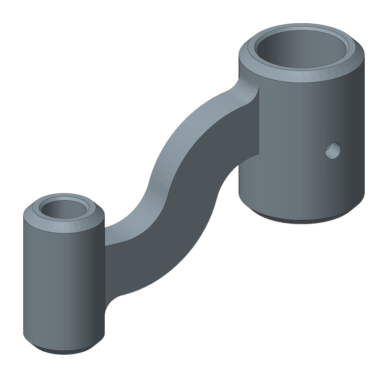

<div align="center">

# Drawing2SW

**Reads your engineering drawings and models the part in SolidWorks.**

DWG · DXF · PDF · images → feature table → STEP / SLDPRT

[](https://github.com/jasonXiao422/drawing2sw/actions/workflows/tests.yml)
[](LICENSE)
[](references/setup.md)
[](references/setup.md)
[](#4-install-the-skill)

[Website](https://jasonxiao422.github.io/drawing2sw/?lang=en) · [中文](README.md) · [Quick start](#quick-start) · [How it works](#how-it-works) · [FAQ](#faq)

<br>

<table>
<tr>
<td align="center" width="55%"></td>
<td align="center" width="45%"></td>
</tr>
<tr><td colspan="2" align="center"><sub><b>V-twin crank case</b>: two 30° cylinder faces, bores offset by 2 mm, eight tapped holes on inclined faces, side walls tangent to the relief arcs. 14 SolidWorks features, every step check passed</sub></td></tr>
<tr>
<td align="center" width="55%"></td>
<td align="center" width="45%"></td>
</tr>
<tr><td colspan="2" align="center"><sub><b>S-shaped pivot arm</b>: R75 / R35 reverse arcs give an R55 centreline turning 74.17° each way, R12 blends and chamfers. 9 SolidWorks features, every step check passed</sub></td></tr>
</table>

<sub>Exercises 17 and 21 from Curtis Waguespack's <a href="https://inventortrenches.blogspot.com/">Inventor practice drawings</a>. The original sheets are copyrighted and not reproduced; the left column is projected back from our model (third angle) for comparison with the original.</sub>

</div>

## What it is

Drawing2SW is an **agent skill**. Give a part drawing to an agent that can run local commands (Claude Code, Codex, and similar). The skill tells it how to read the drawing and fill in a feature table. The scripts in this repo then build the 3D model.

The idea: **the model reads the drawing; deterministic code does the geometry.**

- The model does what it is good at: identifying views, finding dimensions, deciding which dimension belongs to which feature.
- Intersections, tangent points, unit conversion and every SolidWorks API call are handled by scripts. The model never improvises CAD code.
- Every feature records which annotation on the drawing it came from, so mistakes can be traced back to the source.
- After the build, volume, surface area and bounding box are compared automatically, and the report says plainly **what was not checked**.

## Features

| | |
|---|---|
| 📐 **Many inputs** | Native dimension entities from DWG/DXF, positioned text from PDF, automatic view splitting for scans and photos, optional PaddleOCR |
| 🧾 **Traceable intermediate format** | A CAD-neutral JSON feature table. Each feature carries `evidence_refs` and is bound to the source file's SHA-256 |
| 🧮 **Geometry in code** | Write only the dimensions on the drawing. `geom2d` solves tangent arcs, intersections and fillet points |
| 🛠 **Two backends** | CadQuery writes STEP on any OS. On Windows, SolidWorks is driven feature by feature over COM |
| 🔗 **Dimension association check** | Warns when a feature cites a dimension whose value it never uses (likely assigned to the wrong feature), and lists dimensions no feature uses |
| ✅ **Step-by-step self-check** | Each SolidWorks step is compared with CadQuery for volume and position, so failures point to a specific feature |
| 🔍 **Projection review** | Project the model into four wireframe views and overlay them on the drawing |
| 🧪 **Reproducible evaluation** | A synthetic drawing generator that labels which feature every dimension belongs to; scoring covers pose-free geometry (mirrors still fail) and dimension association |

## How it works


Only the diamond is the model. Everything else is ordinary, repeatable Python.

## Quick start

### 1. Requirements

| Need | Notes |
|---|---|
| Windows 10 / 11 | macOS / Linux work for STEP preview only |
| Python **3.11 or 3.12** | CadQuery does not install on 3.13+. Other installed versions can stay |
| SolidWorks 2020+ | Optional. Student and education editions work |
| DWG converter | Optional, only for DWG input. AutoCAD, ZWCAD, GstarCAD or ODA File Converter |

### 2. Install

```powershell
git clone https://github.com/jasonXiao422/drawing2sw.git
cd drawing2sw
powershell -ExecutionPolicy Bypass -File install.ps1
```

`install.ps1` finds Python 3.12, creates `.venv`, installs dependencies and runs an environment check.

<details>
<summary>Manual install / macOS / Linux</summary>

```bash
python3.12 -m venv .venv
.venv/bin/python -m pip install -r requirements.txt
.venv/bin/python scripts/check_env.py
```

Add `--sw` to `check_env.py` to test the SolidWorks connection on Windows.

</details>

### 3. Run an example without any AI

```powershell
.venv\Scripts\python.exe scripts\validate_feature_table.py examples\bracket_prismatic.json
.venv\Scripts\python.exe scripts\preview_cadquery.py examples\bracket_prismatic.json -o work\plate.step
.venv\Scripts\python.exe scripts\verify_model.py examples\bracket_prismatic.json --report work\plate_report.json
```

With SolidWorks installed:

```powershell
.venv\Scripts\python.exe scripts\sw_build.py examples\bracket_prismatic.json -o work\plate.SLDPRT --report work\sw_report.json
```

Close any SolidWorks start-up dialogs first, or the build will wait on them.

<p align="center">

&nbsp;&nbsp;&nbsp;

</p>

### 4. Install the skill

The entry point is [`SKILL.md`](SKILL.md). Put the repository where your agent looks for skills and run `install.ps1` there.

**Claude Code**

```powershell
git clone https://github.com/jasonXiao422/drawing2sw.git "$env:USERPROFILE\.claude\skills\drawing2sw"
cd "$env:USERPROFILE\.claude\skills\drawing2sw"
powershell -ExecutionPolicy Bypass -File install.ps1
```

Then type `/drawing2sw`, or just ask it to model a drawing. For a single project, use `.claude/skills/drawing2sw/` instead.

**Codex:** place it in `.agents/skills/drawing2sw/` in your project and invoke `$drawing2sw`. Check the current Codex docs for the exact location.

**Other agents:** any agent that can read local files and run local Python. Tell it: "Read `drawing2sw/SKILL.md` first and follow it."

### 5. Ask for a part

```text
Use drawing2sw to model D:\drawings\bracket.pdf as a SolidWorks part. Save it to D:\out\
```

The agent will stop and ask about units, projection method, keyway and hole orientation, and any dimension missing from the drawing. **Volume checks cannot catch these. A person has to look.**

## What it can build

| Category | Features |
|---|---|
| Revolved parts | Shafts, flanges, sleeves, discs: `base_revolve`, `revolve` about any axis |
| Prismatic parts | Plates, brackets, bases: `base_extrude`, `extrude`, `cut_extrude` |
| Profiles | Rectangles, circles, polygons, line-and-arc paths, tangent arc loops |
| Holes | Plain, tap drill, counterbore, countersink, drill point, bolt circles |
| Details | Chamfers, fillets, arbitrary inclined planes, cut up to a curved face |
| Gears | Involute spur teeth |
| Drawing setup | mm / inch, first / third angle, scale, dual units, DIMLFAC |

**Not yet:** sheet metal, assemblies, sweep / loft, shell, general mirror and linear patterns. The agent reports the gap instead of faking it.

## How far to trust the result

- **"Passed" only means the measured properties matched.** `drawing_verified` is always `false`.
- **A mirrored part has the same volume.** A wrong projection method passes volume, area and bounding box.
- **Moving a hole 2 mm does not change the volume.** Hole positions need projection review or a boolean comparison with a reference STEP.
- **Both backends agreeing does not mean the drawing was read correctly.** They execute the same table.
- **Evidence links prove traceability,** not that a dimension was assigned to the right feature.

## Evaluation

```powershell
.venv\Scripts\python.exe -m unittest discover -s tests -p "test_v05*.py"
.venv\Scripts\python.exe tests\test_geom2d.py
```

Generate new synthetic drawings (hole plates, bolt-circle disks, stepped shafts, flanges; GB / ISO / ASME; DXF / PDF / PNG / simulated scan):

```powershell
.venv\Scripts\python.exe dev\tools\generate_dataset.py -o work\dataset --count 40 --seed 1
```

To compare models, follow [benchmark.md](references/benchmark.md) and build an answer-free input package with `scripts/benchmark.py prepare`. **Never give the model under test the whole repository;** `data/` contains answers.

## FAQ

<details><summary><b>Can I use it without SolidWorks?</b></summary>

Yes. The CadQuery backend writes STEP, which any CAD tool opens. `.SLDPRT` output needs Windows and SolidWorks.
</details>

<details><summary><b>CadQuery will not install</b></summary>

Check that `.venv` uses Python 3.11 or 3.12. It is only needed for preview.
</details>

<details><summary><b>Cannot connect to SldWorks.Application, or the build hangs</b></summary>

Open SolidWorks once by hand and close every dialog. A hidden dialog is the usual cause of a hang.
</details>

<details><summary><b>Which model works best?</b></summary>

No controlled blind comparison yet, so no claim. The model must see images and run local commands.
</details>

More in [setup and troubleshooting](references/setup.md) (Chinese).

## Contributing

Issues and PRs are welcome, especially drawings the agent misread (only ones you can share publicly) and new feature types. Read [`dev/DEVELOPING.md`](dev/DEVELOPING.md) first: make CadQuery match before touching the SolidWorks backend. Most internal docs are in Chinese.

## License

Code and original synthetic data: [MIT](LICENSE). The two drawings in `data/external/aaditya-jain/` are © Aaditya Jain under their MIT license. See [THIRD_PARTY_NOTICES.md](THIRD_PARTY_NOTICES.md).
