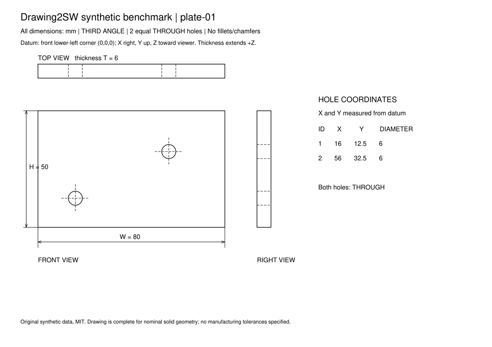
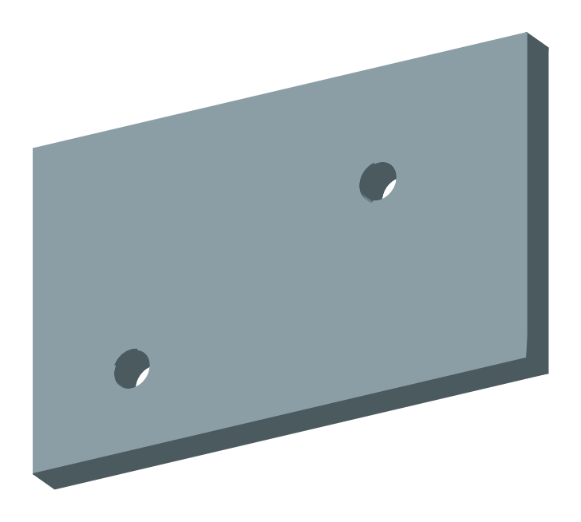
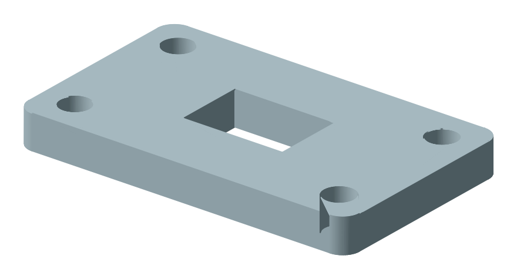
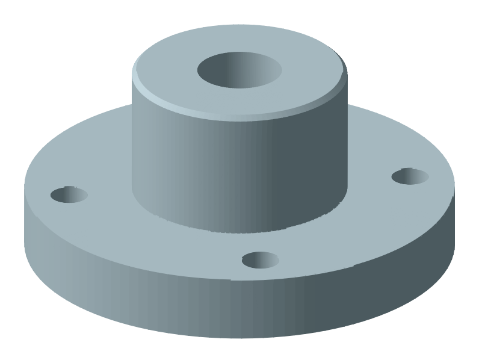

<div align="center">

# Drawing2SW

**把机械零件图交给 AI，拿回可以检查的 SolidWorks 零件。**

DWG · DXF · PDF · 图片 → 特征表 → STEP / SLDPRT

[](https://github.com/jasonXiao422/drawing2sw/actions/workflows/tests.yml)
[](LICENSE)
[](references/setup.md)
[](references/setup.md)
[](#装进-ai)

[项目主页](https://jasonxiao422.github.io/drawing2sw/) · [English](README.en.md) · [快速开始](#快速开始) · [工作原理](#工作原理) · [常见问题](#常见问题)

<br>

<table>
<tr>
<td align="center" width="50%"><br><sub>输入：一张二维零件图</sub></td>
<td align="center" width="50%"><br><sub>输出：按图生成的实体，体积和答案一致</sub></td>
</tr>
</table>

</div>

## 这是什么

Drawing2SW 是一个给 AI Agent 用的 **skill**（技能包）。你把一张零件图给 Claude Code、Codex 这类能运行本地命令的 AI，它会按照 skill 里的流程读图、填写特征表，再调用本仓库的脚本建出三维模型。

它的核心想法很简单：**AI 负责看图，脚本负责算几何。**

- AI 只做它擅长的事：认视图、找尺寸、判断哪个尺寸属于哪个特征。
- 交点、切点、单位换算、SolidWorks API 调用全部由确定性脚本完成，不让 AI 临场写 CAD 代码。
- 每个特征都记录"依据图上哪个标注"，出错时能一路追到原图。
- 建完自动对比体积、表面积、包围盒，并且明确告诉你**哪些没查过**。

## 功能

| | |
|---|---|
| 📐 **多种输入** | DWG、DXF 直接读取原生尺寸实体；PDF 保留文字坐标；扫描图和照片自动切视图，可选 PaddleOCR |
| 🧾 **可追溯的中间表示** | 特征表 JSON 是 CAD 中立的。每个特征带 `evidence_refs`，绑定原图 SHA-256 |
| 🧮 **几何交给脚本** | 只写图上标的尺寸。相切圆弧、交点、圆角切点由 `geom2d` 计算 |
| 🛠 **两个建模后端** | CadQuery 生成 STEP（跨平台，不需要 SolidWorks）；Windows 上通过 COM 驱动 SolidWorks 逐步建模 |
| 🔗 **尺寸归属检查** | 特征引用的尺寸在参数里找不到会警告（多半分错了特征）；图上没被用到的尺寸会列出来 |
| ✅ **逐步自检** | SolidWorks 每建一步都和 CadQuery 对比体积和位置，出错能定位到具体特征 |
| 🔍 **投影复核** | 把模型投影成四向线框，和原图叠在一起看孔位、方向、隐藏线 |
| 🧪 **可复现的评测** | 合成图生成器：每个尺寸都标了属于哪个特征；评分包括几何（不依赖摆放姿态，镜像判错）和尺寸归属 |

## 工作原理


只有菱形那一步是 AI 做的。其余每一步都是普通 Python 脚本，结果可以重复。

## 快速开始

### 1. 准备环境

| 需要 | 说明 |
|---|---|
| Windows 10 / 11 | 只预览 STEP 的话，macOS / Linux 也可以 |
| Python **3.11 或 3.12** | 3.13 以上 CadQuery 装不上。已有其他版本不用卸载 |
| SolidWorks 2020+ | 可选。学生版、教育版都能用（开发用的是 2025 学生版） |
| DWG 转换工具 | 可选，只有输入 DWG 时需要。AutoCAD、中望、浩辰、ODA File Converter 任选一个 |

没有 Python 3.12 的话：

```powershell
winget install Python.Python.3.12
```

### 2. 下载并安装

```powershell
git clone https://github.com/jasonXiao422/drawing2sw.git
cd drawing2sw
powershell -ExecutionPolicy Bypass -File install.ps1
```

`install.ps1` 会找到 Python 3.12，建立独立的 `.venv`，安装依赖，最后跑一遍环境自检。默认源下载失败时会自动换清华镜像。

<details>
<summary>手动安装 / macOS / Linux</summary>

```bash
python3.12 -m venv .venv
.venv/bin/python -m pip install -r requirements.txt
.venv/bin/python scripts/check_env.py
```

Windows 手动安装把 `.venv/bin/python` 换成 `.venv\Scripts\python.exe`。要检查 SolidWorks 连接，给 `check_env.py` 加 `--sw`。

</details>

### 3. 不用 AI，先跑通一个例子

仓库自带写好的特征表。这三条命令不需要 AI，也不需要 SolidWorks：

```powershell
# 校验特征表
.venv\Scripts\python.exe scripts\validate_feature_table.py examples\bracket_prismatic.json

# 生成 STEP 预览
.venv\Scripts\python.exe scripts\preview_cadquery.py examples\bracket_prismatic.json -o work\plate.step

# 和特征表里的标准答案对比
.venv\Scripts\python.exe scripts\verify_model.py examples\bracket_prismatic.json --report work\plate_report.json
```

看到 `通过`，说明环境没问题。`work\plate.step` 可以用任何 CAD 软件打开。

装了 SolidWorks 的话，再试一下真正的建模：

```powershell
.venv\Scripts\python.exe scripts\sw_build.py examples\bracket_prismatic.json -o work\plate.SLDPRT --report work\sw_report.json
```

脚本会自动启动 SolidWorks。第一次启动前请关掉所有弹窗（更新提示、许可提示），否则会卡住。

<p align="center">

&nbsp;&nbsp;&nbsp;

<br><sub>仓库示例：棱柱件 <code>bracket_prismatic.json</code> 和回转件 <code>flange_revolved.json</code></sub>
</p>

### 4. 装进 AI

skill 的入口是 [`SKILL.md`](SKILL.md)。把整个仓库放到 AI 能找到 skill 的目录里，并在那个目录里运行过 `install.ps1`。

**Claude Code**

```powershell
git clone https://github.com/jasonXiao422/drawing2sw.git "$env:USERPROFILE\.claude\skills\drawing2sw"
cd "$env:USERPROFILE\.claude\skills\drawing2sw"
powershell -ExecutionPolicy Bypass -File install.ps1
```

之后在 Claude Code 里输入 `/drawing2sw`，或者直接说"按这张图建模"。只想在某个项目里用，就放到项目的 `.claude/skills/drawing2sw/`。

**Codex**

放到项目的 `.agents/skills/drawing2sw/`，用 `$drawing2sw` 调用。具体位置以 Codex 当前版本的文档为准。

**其他 Agent**（豆包、Cursor 等）

只要 AI 能读本地文件、能运行本地 Python 就可以。告诉它："先读 `drawing2sw/SKILL.md`，按里面的步骤做。"

### 5. 让 AI 建一个零件

```text
用 drawing2sw 把 D:\drawings\支架.pdf 建成 SolidWorks 零件，输出到 D:\out\
```

AI 会依次：预处理图纸 → 确认单位和投影法 → 填特征表 → 校验 → 生成 STEP 预览给你看 → 你确认后再建 SolidWorks 零件。

单位、投影法、键槽和孔的方位、图上没标的尺寸，AI 会停下来问你。**这些判断体积校验发现不了，一定要人看。**

## 支持什么零件

| 类别 | 特征 |
|---|---|
| 回转件 | 轴、法兰、套筒、盘类：`base_revolve`、任意轴 `revolve` |
| 棱柱件 | 板、支架、底座：`base_extrude`、加料 `extrude`、`cut_extrude` |
| 轮廓 | 矩形、圆、多边形、直线加圆弧路径、切线连接的圆弧圈 `tangent_loop` |
| 孔 | 光孔、螺纹底孔、沉孔、埋头孔、钻尖、分布圆孔 |
| 细节 | 倒角、圆角、任意斜面、切到曲面为止 |
| 齿轮 | 渐开线直齿 `spur_gear_teeth` |
| 图纸设定 | mm / inch、第一角 / 第三角投影、比例、双单位、DIMLFAC |

**暂不支持：** 钣金、装配体、扫描 / 放样、抽壳、通用镜像和线性阵列。遇到这些，AI 会说明做不了，而不是硬凑。

完整写法见 [特征表说明](references/feature-table.md)。

## 结果能信到什么程度

这一节比功能列表更重要。

- **"通过"只代表测量属性对上了。** `verify_model.py` 的 `drawing_verified` 永远是 `false`。
- **镜像件体积相同。** 投影法判反了，体积、表面积、包围盒全都能通过。
- **孔移动 2 mm，体积也不变。** 孔位要靠投影复核或和参考 STEP 做布尔比较。
- **两个后端一致，不等于读图正确。** 它们执行的是同一张特征表，读错了会一起错。
- **证据链接只证明可追溯。** 它说明尺寸来自原图哪里，不证明尺寸被分给了正确的特征。

所以交付时，AI 会列出：通过了哪些检查、哪些没查、有哪些假设和人工修正。

## 目录结构

```text
drawing2sw/
├── SKILL.md              # skill 入口，AI 从这里开始读
├── install.ps1           # Windows 一键安装
├── scripts/              # 全部确定性工具
│   ├── preprocess_drawing.py   # 图纸预处理，输出证据
│   ├── validate_feature_table.py
│   ├── preview_cadquery.py     # CadQuery → STEP
│   ├── sw_build.py             # SolidWorks COM 建模
│   ├── verify_model.py         # 对答案
│   ├── project_model.py        # 投影复核
│   └── geom2d.py / ftable.py   # 几何计算和特征表展开
├── references/           # 读图规则、坐标约定、单位标准，AI 按需读取
├── schema/               # 特征表和证据的 JSON Schema
├── examples/             # 示例特征表和完整的 v0.5 证据示例
├── data/                 # 评测数据：合成图 + 第三方案例
├── tests/                # 单元测试
└── docs/                 # 项目主页（GitHub Pages）
```

## 评测

```powershell
.venv\Scripts\python.exe -m unittest discover -s tests -p "test_v05*.py"
.venv\Scripts\python.exe tests\test_geom2d.py
```

生成新的合成图（孔板、分布圆盘、阶梯轴、法兰，GB / ISO / ASME，DXF / PDF / PNG / 模拟扫描件）：

```powershell
.venv\Scripts\python.exe dev\tools\generate_dataset.py -o work\dataset --count 40 --seed 1
```

比较不同模型的读图能力，请按 [评测说明](references/benchmark.md) 用 `scripts/benchmark.py prepare` 生成不含答案的输入包。**不要把整个仓库交给被测模型**，`data/` 里有答案。

合成集都是简单零件族，不能用来宣称真实图纸的成功率。

## 常见问题

<details>
<summary><b>没有 SolidWorks 能用吗？</b></summary>

能。CadQuery 后端生成 STEP，任何 CAD 软件都能打开，macOS / Linux 也能跑。只有生成 `.SLDPRT` 需要 Windows + SolidWorks。
</details>

<details>
<summary><b>CadQuery 装不上</b></summary>

先确认 `.venv\Scripts\python.exe --version` 是 3.11 或 3.12。3.13 以上目前装不上。实在不行可以跳过，它只用于预览。
</details>

<details>
<summary><b>"无法连接 SldWorks.Application" / 建模卡住不动</b></summary>

先手动打开一次 SolidWorks，关掉所有对话框再试。卡住通常是 SolidWorks 里有弹窗没关。还不行就用管理员终端试一次。
</details>

<details>
<summary><b>DWG 打不开</b></summary>

运行 `.venv\Scripts\python.exe scripts\dwg2dxf.py --check` 看哪种转换方式可用。装一个 ODA File Converter，或在 CAD 软件里另存为 DXF。
</details>

<details>
<summary><b>中文终端报 UnicodeEncodeError</b></summary>

终端是 GBK 编码，打印 Ø 这类字符会出错。先运行 `$env:PYTHONIOENCODING="utf-8"` 再执行命令。
</details>

<details>
<summary><b>哪个 AI 效果最好？</b></summary>

还没有做统一盲测，不下结论。需要模型能看图、能运行本地命令。看不懂视图关系的模型，工具也补不上。
</details>

更多排查见 [安装与排查](references/setup.md)。

## 路线图

- [x] DWG / DXF / PDF / 图片输入
- [x] CadQuery 和 SolidWorks 双后端，逐步自检
- [x] v0.5 证据链：特征绑定原图标注
- [x] 合成评测集与盲测打包
- [ ] 剖视图自动比对
- [ ] 镜像、线性阵列、抽壳
- [ ] 多模型统一盲测结果

## 参与贡献

欢迎提 Issue 和 PR。特别需要：

- **读错的图。** 附上图纸（确认可以公开）、AI 填的特征表和你期望的结果。
- **新特征类型。** 请先读 [`dev/DEVELOPING.md`](dev/DEVELOPING.md)，CadQuery 先对上体积，再改 SolidWorks 后端。

提交前跑一遍上面的测试。改了建模代码的，`examples/` 里三张表的 CadQuery 预览体积要和以前一样。

## 致谢与许可

代码和原创合成数据采用 [MIT 许可](LICENSE)。`data/external/aaditya-jain/` 下的两组图纸版权属于 Aaditya Jain，保留其 MIT 许可。依赖和第三方数据见 [THIRD_PARTY_NOTICES.md](THIRD_PARTY_NOTICES.md)。

设计上借鉴了 SolidPilot / MCP_CAD 的受限 CAD 执行与中间表示，CAD-Coder 的 CadQuery 思路，以及 PaddleOCR、eDOCr2、Drawing2CAD 的输入处理和评测设计。

<div align="center"><sub>如果这个项目对你有帮助，点个 ⭐ 让更多人看到。</sub></div>
